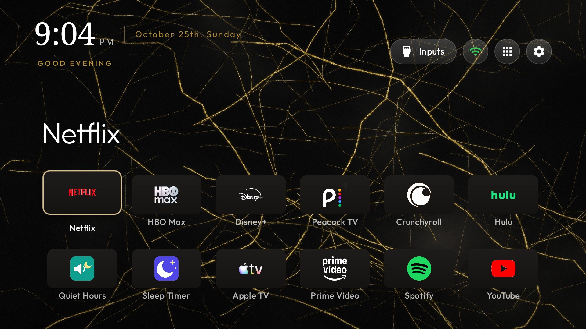
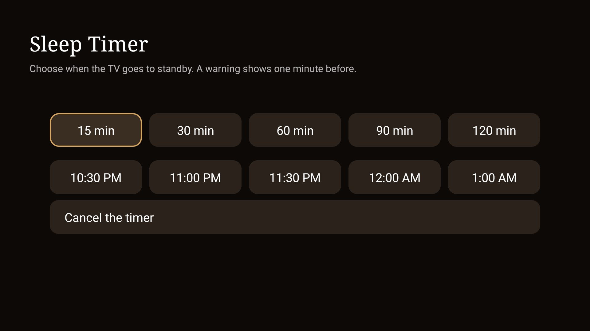
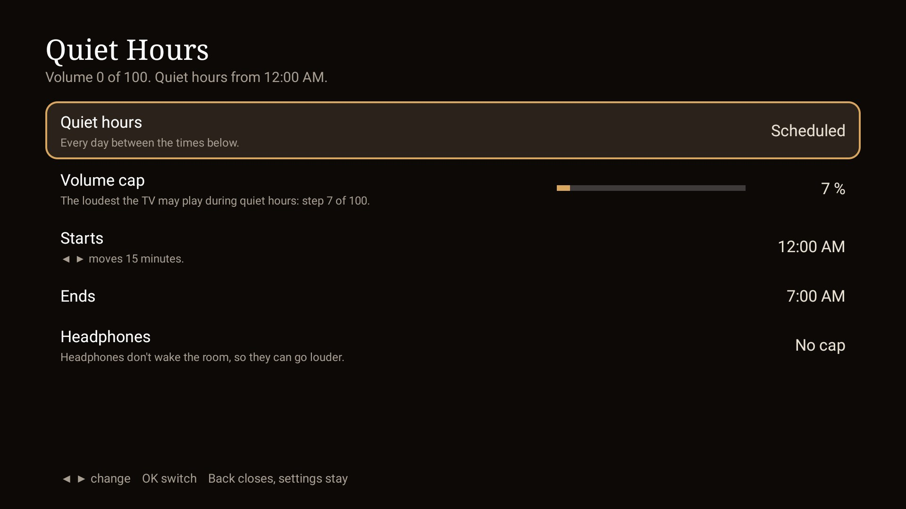
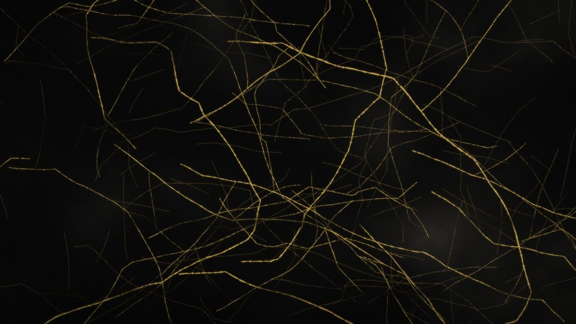

# TV Home kit

An ad-free, custom home screen for Google TV and Android TV, with skins you can make by describing them to Claude.

It builds on [Clean Your TV](https://github.com/Gathin23/cleanyourtv) (MIT), an open-source debloat tool and launcher, and adds:

- **A patch for the launcher**: one tile colour with each app's real logo cut out, a gold accent, a serif clock, a greeting under the clock, the date as "October 25th, Sunday", a photo screensaver and a nightly auto-off time.
- **A cloud build** in GitHub Actions, so you need no Android Studio or SDK on your computer.
- **Six skins**: Marble, Cinema, Midnight, Synthwave, Aurora and Black. Each is a theme file and a wallpaper drawn in Python.
- **Two night add-ons**, restyled to match: Sleep Timer (minutes or a clock time) and Quiet Hours (a volume cap from midnight to 7 AM).
- **Scripts** to install everything, switch skins and get past the TCL Wi-Fi trap that blocks removing Google TV's home screen.
- **A Claude skill** (`skill/SKILL.md`): describe a look ("rainy Tokyo night") and Claude draws, checks and applies a new skin.

| Sleep Timer | Quiet Hours |
|---|---|
|  |  |

| Marble | Cinema | Midnight |
|---|---|---|
|  |  |  |
| **Synthwave** | **Aurora** | **Black** (plain) |
|  |  | |

## Works on

Google TV and Android TV sets on Android 9 or later: TCL, Sony, Hisense, Philips, Chromecast with Google TV, onn, Nvidia Shield. Built and tested on a TCL 55" Google TV (G10, Android TV 12). It does not work on LG (webOS), Samsung (Tizen) or Roku.

## Start

1. Click **Use this template** to make your own copy, then clone it.
2. Read [docs/EXPLAINED.md](docs/EXPLAINED.md) (plain English, five minutes), then follow [docs/IMPLEMENTATION-GUIDE.md](docs/IMPLEMENTATION-GUIDE.md). Allow 30 to 90 minutes.
3. Put Google's [platform-tools](https://developer.android.com/tools/releases/platform-tools) in `.upstream\platform-tools\` and clone Clean Your TV into `.upstream\cleanyourtv\` (the guide shows how). `.upstream\` is ignored by git.
4. Set the TV's address once: `$env:TV_HOST = '<TV_IP>'`.

Or hand the guide to an AI assistant: section 14 has a prompt to paste.

## What it changes, and how to undo it

Everything is reversible. Built-in apps are disabled, not deleted; Clean Your TV records what it changed and its `restore` script puts it back. Section 13 of the guide undoes the whole setup. Debugging is switched off at the end, and the launcher has no internet permission.

## Layout

| Path | What it is |
|---|---|
| `.github/workflows/build-launcher.yml` | Builds the launcher and both add-ons at a pinned Clean Your TV commit, with the patch applied |
| `patches/tv-home.patch` | Every source change to the launcher and add-ons |
| `skins/<name>/` | `config.json` and `make_wallpaper.py` (plus the rendered `wallpaper.jpg`) |
| `tools/skin.ps1` | List, render, create, apply and reset skins |
| `tools/install-launcher.ps1` | Install the latest build and restore helpers, screensaver and skin |
| `tools/wifi-reown.ps1` | Moves the saved Wi-Fi off Google's setup wizard (asks for the password locally) |
| `tools/wall.py` | Wallpaper drawing toolkit |
| `skill/SKILL.md` | The `tv-skin` Claude skill |
| `docs/` | The guide and the plain-English explainer |

## Credits and license

[Clean Your TV](https://github.com/Gathin23/cleanyourtv) by Gathin and its contributors (launcher, scripts, model lists, the Sleep Timer and Quiet Hours add-ons), MIT. [AdGuard DNS](https://adguard-dns.io). This kit is MIT too; see [LICENSE](LICENSE).
